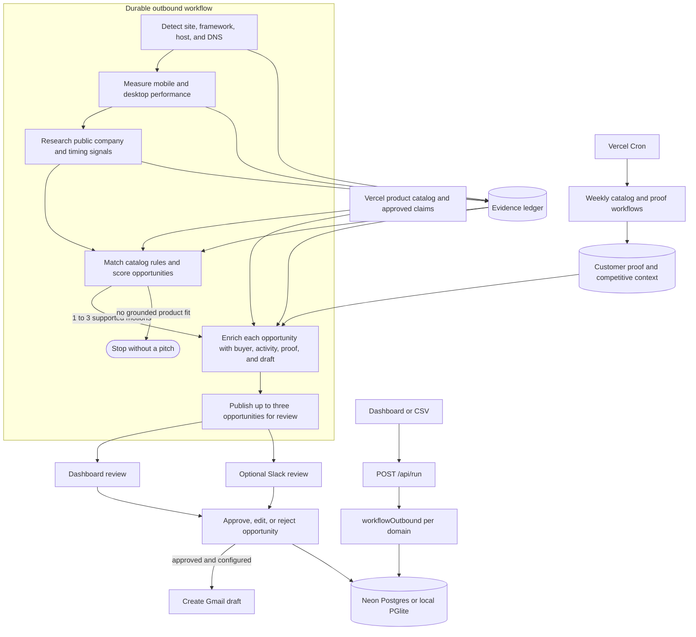
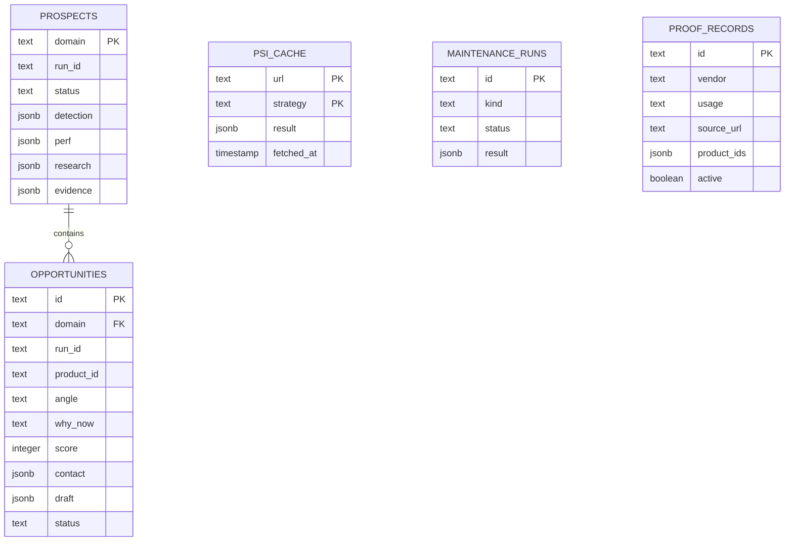

# Next Prospect ▲

**Next Prospect** is an account-level outbound planning tool for Vercel. It turns
public company evidence into up to three timely, product-specific sales angles,
identifies the right buyer for each, and drafts grounded first-touch outreach for
human review.

The core question is not simply whether an account is worth contacting. It is:

> Which Vercel products fit this company now, what distinct conversations could
> a rep lead with, and who is most likely to own each problem?

Approval can optionally create a Gmail draft. A person still reviews and sends it.

> **Working with an AI agent?** Start with [AGENTS.md](./AGENTS.md). It links to
> the product, architecture, workflow, database, verification, and deployment
> guides that govern changes to this repository.

## Product objective

Vercel's GTM organization can source a large number of prospects. The expensive
part is turning scattered signals into outreach that is specific enough to be
useful. A rep still needs to connect the company's current priorities to a
relevant Vercel product, explain why the timing matters, and find the person who
owns that problem.

Next Prospect does that planning before the rep writes from scratch. For every
submitted domain, it can surface several independent sales approaches rather
than forcing the account into one generic pitch.

### In scope

- Public website, company, hiring, launch, regional, and timing research.
- Evaluation against Vercel's full product and capability catalog.
- Up to three distinct product opportunities per account.
- A product-specific buyer and relevant public activity for each opportunity.
- Region-aware drafting, including privacy context only when evidence and the
  selected product support it.
- Dashboard review, optional Slack review, and optional Gmail draft creation.

### Not in scope

- Connections to Vercel's internal CRMs or proprietary data sources.
- Automatic sending or sequencing.
- Multi-tenant authentication, authorization, and rep-level personalization.
- Large-scale latency or concurrency optimization.
- Inference about private product use, contracts, spend, or internal plans.

## What it produces

The unit of output is a **product opportunity**, not a generic contact or a data
dump. Each opportunity owns:

- the Vercel product and sales angle;
- why the conversation is relevant now;
- a deterministic score and cited signal breakdown;
- the likely buyer or an explicit target role;
- attributable public buyer activity;
- relevant Vercel customer proof;
- internal-only competitive context;
- a concise email draft and rep brief; and
- its own approval, edit, or rejection state.

The account page leads with these ranked conversations. Raw research and source
receipts remain available for verification without becoming the primary user
experience.

## System architecture

Next Prospect is a Next.js App Router application with a durable Vercel Workflow
for each normalized domain. Route handlers and pages stay thin; workflow steps
and library modules own external work, persistence, scoring, and safety rules.



One workflow run owns one account snapshot. Opportunity writes are scoped to the
owning `runId`, so a stale or superseded run cannot overwrite the current account.
Batches are staggered by four seconds to reduce PSI and Exa quota bursts.

## Workflow

For each domain, the durable workflow runs these stages:

1. **Detect**
   - Fetches `robots.txt`, performs one bounded homepage request, and resolves DNS.
   - Scores Next.js confidence and identifies the visible hosting/CDN provider.
   - Does not use a headless browser.

2. **Measure**
   - Runs PageSpeed Insights for mobile and desktop in parallel.
   - Keeps Lighthouse lab data separate from CrUX real-user data.
   - Caches results for 24 hours and degrades cleanly when quota is unavailable.

3. **Research**
   - Uses Exa to collect public company, hiring, launch, region, technical, social,
     and timing evidence.
   - Drops research items whose source URL was not returned by a tool call.

4. **Plan opportunities**
   - The model proposes matches between evidence and known catalog signal rules.
   - Deterministic code validates, scores, deduplicates, sorts, and keeps up to
     three products with grounded product fit.

5. **Enrich each opportunity**
   - Finds a product-specific buyer or records an explicit target role.
   - Collects attributable public activity for the selected buyer.
   - Selects Vercel customer proof and separately labeled competitive context.
   - Drafts using prospect evidence and approved catalog claims only.

6. **Request review**
   - Publishes each opportunity independently to the dashboard and optional Slack.
   - The durable run finishes at `awaiting_approval`; decision routes handle the
     later approval lifecycle.

## Evidence and grounding

Detection, performance, and research become `EvidenceItem` records with stable
IDs. Planning and drafting may cite only those IDs.

```text
[detect.host.x-amz-cf-id]  CloudFront header observed on the public site
[psi.mobile.field.ttfb]    Mobile real-user TTFB at p75: 1840 ms
[research.launch.0]        Product launch with date and retrieved source URL
```

`lib/grounding.ts` enforces the boundary:

- Research URLs must come from returned tool results.
- Unknown evidence IDs receive one repair pass, then the unsupported claim is
  removed.
- Draft numbers must resolve to the evidence ledger.
- Internal evidence IDs and scoring mechanics are removed from customer-facing
  copy.
- The UI links every visible citation back to its source receipt.

## Catalog and scoring

`lib/catalog/products.ts` is the source of truth for the Vercel product surface.
Each standalone product defines target buyers, observable public signal rules,
approved claims, and whether it can create an independent opportunity.
Capabilities roll up to a parent product instead of creating repetitive pitches.

The model interprets evidence and proposes matches. Code owns the numeric score:

| Category | Maximum |
| --- | ---: |
| Product fit | 45 |
| Timing trigger | 20 |
| Account potential | 20 |
| Buyer confidence | 15 |
| **Total** | **100** |

Confidence and freshness affect individual signals. Only the strongest supported
account tier contributes. A candidate with no grounded product-fit points is
suppressed.

Observed Vercel hosting suppresses only an invalid Vercel Platform migration
motion. It remains useful expansion context for other products such as AI Gateway,
Workflow, security, or analytics.

## Model and code boundaries

| Model-assisted | Code-controlled |
| --- | --- |
| Research public sources | Validate retrieved URLs and evidence IDs |
| Propose catalog rule matches | Apply weights, caps, confidence, and freshness |
| Select a product-specific buyer | Enforce product-fit and suppression rules |
| Summarize buyer activity | Keep competitor context out of drafting |
| Draft concise outreach | Validate approval tokens and state transitions |

Approved product claims come from the catalog, not model memory. Customer proof
can support review but does not add scoring points. Competitive case studies are
stored for internal context and are never passed into the outreach prompt.

## Persistence model

Drizzle uses one schema with Neon in hosted environments and PGlite locally.



`prospects` stores the latest account state and shared evidence. `opportunities`
stores the independently reviewable product angles. The opportunity is the
authoritative decision unit; the prospect status is a dashboard summary.

## Retry and failure behavior

External stages degrade when optional data is unavailable instead of inventing
facts. PSI quota exhaustion continues without metrics. Missing or invalid Exa
credentials continue without research. Unexpected failures persist a bounded
account error and fail the durable run.

The dashboard exposes a protected **Retry** action for failed accounts. Retry
starts a replacement workflow on the latest deployment and resumes from the last
persisted application checkpoint. Completed detection, performance, research,
planning, drafts, and reviewable opportunities are reused instead of repeated.

This is application-level recovery. A terminal Workflow SDK run is not reopened.

## Weekly maintenance

Vercel Cron starts two authenticated durable workflows every Monday:

- **14:00 UTC:** audit official Vercel documentation, changelog entries, and
  announcements for possible catalog changes.
- **15:00 UTC:** refresh Vercel, Cloudflare, and Railway customer stories.

Maintenance never edits the active catalog or scoring rules automatically.
Catalog changes still require a reviewed code change. Refreshed competitor stories
remain internal-only.

## Project structure

```text
app/
  page.tsx                                account dashboard
  prospect/[domain]/page.tsx              account brief and opportunities
  about/page.tsx                          product and architecture overview
  api/run/route.ts                        start one workflow per domain
  api/prospects/[domain]/retry/route.ts   protected checkpoint retry
  api/opportunities/[id]/decision/route.ts
  api/opportunities/[id]/gmail-draft/route.ts
  api/slack/route.ts                      optional Slack interactions
  api/cron/                               authenticated maintenance triggers

workflows/
  outbound/index.ts                       workflow orchestration and retry
  outbound/steps.ts                       retry-safe persisted stages
  maintenance/                            weekly catalog and proof workflows

lib/
  catalog/                                product definitions and signal rules
  detect/                                 website, Next.js, host, and DNS detection
  db/                                     Drizzle schema and data access
  refresh/                                catalog and proof refresh services
  opportunity-services.ts                planning, buyer selection, and drafting
  opportunity-decision.ts                decisions and Gmail handoff
  scoring.ts                              deterministic scoring and caps
  grounding.ts                            evidence validation and citation repair
  psi.ts                                  PageSpeed collection and cache
  slack.ts                                Block Kit review cards
  gmail.ts                                Gmail draft creation

eval/
  run.ts                                  catalog and scoring checks
  detect.ts                               labelled detector evaluation
  e2e.ts                                  isolated account-to-approval fixture
```

## Local development

Prerequisites: Node 22.17+ and pnpm 11.10.

```bash
pnpm install
cp .env.example .env.local
pnpm db:migrate
pnpm dev
```

With `DATABASE_URL`, migrations and runtime data use Neon. Without it in local
development, the app uses embedded PGlite at `./.pglite`.

Start a batch from the dashboard or CLI:

```bash
pnpm run:csv data/seed.csv
```

### Environment

| Variable | Used for | Notes |
| --- | --- | --- |
| `AI_GATEWAY_API_KEY` | Research, planning, buyer selection, drafting | Optional on Vercel or after `vercel env pull` when OIDC is available. |
| `AI_MODEL` | AI Gateway model | Defaults to `openai/gpt-5`. |
| `EXA_API_KEY` | Public research | Missing credentials degrade to detection and performance evidence. |
| `PSI_API_KEY` | PageSpeed Insights | Recommended because keyless quota is effectively unavailable. |
| `DATABASE_URL` | Hosted persistence | Supplied by the Neon Marketplace integration. |
| `RUN_SECRET` | Privileged dashboard writes | Required in production for runs, retries, and decisions. |
| `CRON_SECRET` | Maintenance routes | Added to Vercel Cron requests as a bearer token. |
| `REP_NAME` | Draft greeting/sign-off context | Written directly into generated drafts. |
| `SLACK_*` | Optional Slack review | Dashboard review works without Slack. |
| `GOOGLE_*`, `GMAIL_REFRESH_TOKEN` | Optional Gmail drafts | Uses the `gmail.compose` scope and `drafts.create`. |
| `APP_URL` | Public Slack links | Defaults to the production Vercel URL. |

## Optional integrations

### Slack review

1. Create the app from [manifest.json](./manifest.json).
2. Set the interactivity URL to `https://<deployment>/api/slack`.
3. Configure `SLACK_BOT_TOKEN`, `SLACK_SIGNING_SECRET`, and `SLACK_CHANNEL_ID`.
4. Invite the bot to the review channel.

Each opportunity gets its own Approve, Edit, and Reject actions. Slack is an
optional review surface; the dashboard remains authoritative.

### Gmail drafts

1. Enable the Gmail API in Google Cloud.
2. Create a Desktop OAuth client with the `gmail.compose` scope.
3. Add the client ID and secret to `.env.local`.
4. Run `pnpm gmail:auth` to create `GMAIL_REFRESH_TOKEN`.

On approval, the app may call `drafts.create`. It does not call a send endpoint.
Recipient addresses are included only when published evidence provides one; the
app never guesses an email address.

## Verification

```bash
pnpm typecheck       # TypeScript and server/client import boundaries
pnpm eval            # Catalog and deterministic scoring expectations
pnpm eval:detect     # Labelled Next.js and host detector sanity check
pnpm test:e2e        # Isolated account -> opportunity -> decision path
pnpm build           # Production Next.js and Workflow build
pnpm verify          # Complete non-browser gate used by CI
```

The detector dataset contains 15 hand-labelled domains and is a sanity check,
not an unbiased benchmark. Browser QA remains required for interface changes.

## Deployment

GitHub Actions runs `pnpm verify` on pull requests and pushes to `main`. Vercel's
Git integration creates branch previews and deploys `main` after the configured
checks pass.

First-time setup:

```bash
vercel link
vercel integration add neon --plan free_v3
vercel env add EXA_API_KEY
vercel env add PSI_API_KEY
vercel env add RUN_SECRET
pnpm db:migrate
```

Normal release:

```bash
pnpm verify
git push origin main
```

See [docs/shipping/deployment.md](./docs/shipping/deployment.md) for migration,
release verification, and rollback guidance.

## Origin

The repository began as an unmodified import of
[vercel-labs/lead-agent](https://github.com/vercel-labs/lead-agent). The current
implementation keeps its durable workflow and Vercel-native foundations while
changing the product from one inbound lead summary into multiple independently
reviewable outbound product opportunities.

## License

MIT, as is the original [lead-agent](https://github.com/vercel-labs/lead-agent).
