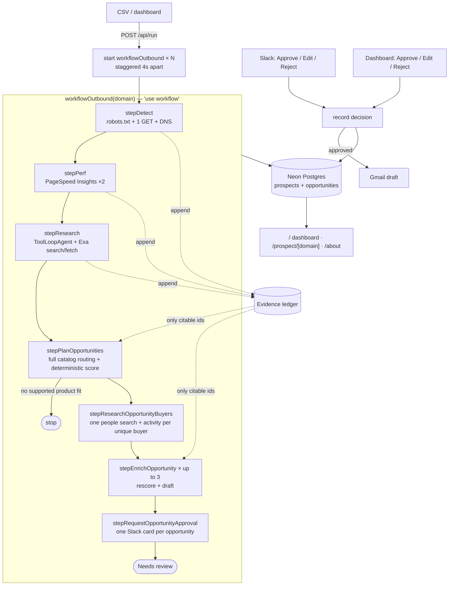

# Next Prospect ▲

**Next Prospect** is an account-level outbound opportunity planner for Vercel. It researches a
company, evaluates the evidence against Vercel's full product catalog, ranks up to three
product-specific conversations, finds the right buyer for each, and drafts personalized,
fully cited outreach for **human approval**.

> Nothing is ever sent. "Approve" only marks a draft approved.

> **Working with an AI agent?** Start with [AGENTS.md](./AGENTS.md). It is the
> table of contents for product intent, architecture boundaries, workflow and
> database guides, verification, deployment, and task-specific skills.

## What it does

For each domain in a CSV, one durable workflow:

1. **Detect**: one polite homepage fetch (robots.txt respected, identifying UA, timeouts,
   no headless browser) plus DNS. It scores Next.js confidence from `__NEXT_DATA__`,
   `self.__next_f`, `/_next/static`, `x-powered-by`, `x-nextjs-*` and `Vary: RSC`, and
   identifies the host (Vercel, Netlify, Cloudflare, AWS/CloudFront/Amplify, Fastly,
   Akamai, GCP, Azure, Render, Fly, …). Existing Vercel hosting becomes expansion context;
   it suppresses only an incorrect hosting-migration opportunity.
2. **Measure**: PageSpeed Insights for mobile and desktop. Lighthouse lab LCP/CLS/TTFB/TBT
   and CrUX real-user p75 LCP/INP/CLS/TTFB are kept separate. Cached for 24h.
3. **Research**: an Exa research agent collects company, region, launches, hiring, job,
   technical, social, and timing signals. Every item must cite a URL a tool returned.
4. **Route and score**: the model matches grounded evidence to known catalog signal rules;
   code applies deterministic confidence, freshness, category caps, and one evidence-backed
   account-potential tier.
5. **Choose buyers**: one people search assigns a verified contact to each selected product
   opportunity. Public activity is researched once per unique buyer and tailored to each
   opportunity; an explicit target role remains when no person can be grounded.
6. **Draft**: each opportunity receives a 60–120 word email and rep brief using only its
   selected evidence and approved product claims. Expansion drafts may build on an observed
   Vercel hosting footprint without claiming private account knowledge.
7. **Approve**: each opportunity independently ends at Needs review. Slack or the dashboard
   records Approve / Edit / Reject. Nothing is automatically sent.
8. **Gmail draft**: on approval, the final (possibly edited) email becomes a **draft in
   the rep's Gmail**, linked from Slack and the brief. It uses the `gmail.compose` scope
   and only calls `drafts.create`, so the rep still reviews it and clicks Send.

If a durable run exhausts its automatic retries, the account error banner offers a
protected **Try again** action. It clears the failed account state and starts the same
workflow again from the beginning.

## Architecture



### The evidence ledger (how "never invent facts" is enforced)

Every observation becomes an `EvidenceItem` with a stable id:

```
[detect.host.x-amz-cf-id]  x-amz-cf-id header (CloudFront) → aws: x-amz-cf-id: MQ4R…
[psi.mobile.field.ttfb]    Real-user TTFB, field p75 (mobile): 1840 ms
[research.news.0]          News (2026-06-12): Acme raises $40M Series B (source: https://…)
```

- `lib/grounding.ts` **drops research items** whose `sourceUrl` wasn't returned by a tool call.
- Opportunity and draft claims must cite ledger ids. Unknown ids trigger **one repair
  pass**, then the claims are pruned.
- Numbers in the email that don't appear in the ledger are retried once, then shown to the
  reviewer as warnings.
- The UI renders every citation as a chip that jumps to the ledger row.

## Project structure

```
app/
  page.tsx                      dashboard (sortable/filterable, live-refreshing)
  prospect/[domain]/page.tsx    full brief: evidence, CWV, research, reasoning, draft
  about/page.tsx                pitch write-up
  api/run/route.ts              POST CSV/list → one workflow per domain
  api/secret/route.ts           check RUN_SECRET without starting a run
  api/slack/route.ts            Approve / Edit (modal) / Reject
  api/opportunities/[id]/decision/route.ts  dashboard opportunity approvals
workflows/outbound/
  index.ts                      the durable workflow
  steps.ts                      'use step' functions (persist each stage)
lib/
  catalog/                      full product/capability catalog and signal rules
  refresh/                      customer-proof refresh service
  scoring.ts                    deterministic signal scoring and caps
  opportunity-services.ts      routing, buyer selection, product-specific drafting
  opportunity-decision.ts      independent opportunity approval + Gmail handoff
  detect/                       fetch (robots, caps), nextjs + host rules, DNS
  psi.ts                        PageSpeed Insights + cache + CWV thresholds
  services.ts                   company research agent and draft formatting
  prompts.ts                    research and drafting instructions
  grounding.ts                  evidence ledger enforcement
  slack.ts                      Block Kit card + edit modal
  approval-token.ts             ties a Slack or dashboard click to one run
  db/                           Drizzle schema and persistence helpers
workflows/maintenance/          weekly customer-proof refresh workflow
tests/                          deterministic and isolated behavior tests
  assertions.ts                 catalog and scoring assertions
  e2e.ts                        isolated account → opportunity → approval test
  detect.ts                     optional live detector fixture check
```

## Run it

Prerequisites: Node 22.17+, pnpm 11.10.

```bash
pnpm install
cp .env.example .env.local        # fill in keys (see below)
pnpm db:migrate                   # Neon if DATABASE_URL is set, else local PGlite
pnpm dev
```

Start a batch by pasting domains on the dashboard, or from the CLI:

```bash
pnpm run:csv data/seed.csv
```

Other scripts:

```bash
pnpm check                        # types + unused imports/variables/parameters
pnpm test                         # deterministic assertions + isolated E2E
pnpm detect                       # live labelled detector fixture
pnpm detect:domain nike.com       # ad-hoc detector check
npx workflow web                  # inspect workflow runs locally
```

### Environment

| Var | Needed for | Notes |
|---|---|---|
| `AI_GATEWAY_API_KEY` | planning, drafting, research | Optional on Vercel / after `vercel env pull` (OIDC). The team needs a card on file to unlock AI Gateway's free credits. |
| `AI_MODEL` | — | Any Gateway model id; default `openai/gpt-5`. |
| `EXA_API_KEY` | research | If unset, public-web research and contact enrichment are skipped; planning can still use detection and performance evidence. |
| `PSI_API_KEY` | performance | Keyless quota is effectively zero. After retries the run continues without perf. |
| `DATABASE_URL` | storage | Added by the Neon Marketplace integration. Falls back to PGlite in dev. |
| `SLACK_BOT_TOKEN`, `SLACK_SIGNING_SECRET`, `SLACK_CHANNEL_ID` | Slack approvals | Optional; the dashboard can approve too. |
| `GOOGLE_CLIENT_ID`, `GOOGLE_CLIENT_SECRET`, `GMAIL_REFRESH_TOKEN` | Gmail drafts | Optional; see Gmail drafts below. |
| `REP_NAME` | drafts | Required sender name written directly into every draft sign-off. |
| `RUN_SECRET` | prod | Required to start runs and approve from the dashboard. |
| `CRON_SECRET` | prod | Set by Vercel Cron and required by the weekly proof refresh route. |
| `APP_URL` | Slack links | Defaults to the Vercel production URL. |

### Slack

1. Create an app **from manifest** using `manifest.json`, and set the interactivity URL to
   `https://<your-deployment>/api/slack`.
2. Install to your workspace, invite the bot to a channel, and set the three `SLACK_*` vars.
3. Qualified prospects are posted as a card with **Approve / Edit / Reject**. Edit opens a
   modal; submitting it saves the edit and approves.

### Gmail drafts

1. In Google Cloud console: enable the **Gmail API**. Under **OAuth consent screen**, choose
   External, add yourself as a test user, and add the `gmail.compose` scope.
2. **Credentials → Create credentials → OAuth client ID → Desktop app.** Put the ID and
   secret in `.env.local` as `GOOGLE_CLIENT_ID` / `GOOGLE_CLIENT_SECRET`.
3. `pnpm gmail:auth` opens Google's consent screen and saves `GMAIL_REFRESH_TOKEN` to
   `.env.local`.
4. Add all three to Vercel, then redeploy.

While the OAuth app is in *Testing* mode, Google expires refresh tokens after 7 days. When
that happens, briefs show "re-run `pnpm gmail:auth`". Drafts have no recipient unless the
buyer's email was published on a retrieved page.

### Deploy

GitHub Actions verifies every pull request and push to `main`. Vercel's Git
integration creates previews for branches and publishes `main`; CI does not
hold deployment credentials or run a second deploy command.

First-time project setup:

```bash
vercel link
vercel integration add neon --plan free_v3    # free Postgres, sets DATABASE_URL
vercel env add EXA_API_KEY / PSI_API_KEY / RUN_SECRET / SLACK_*
pnpm db:migrate
```

Normal release:

```bash
pnpm verify
git push origin main              # CI runs; Vercel builds and deploys
```

## Future Improvements

- Add a reviewed catalog-audit workflow and review surface that compares official Vercel
  product changes with the code-owned catalog. It must never change scoring rules,
  approved claims, or product eligibility automatically.

## License

MIT, as is the original [lead-agent](https://github.com/vercel-labs/lead-agent).
