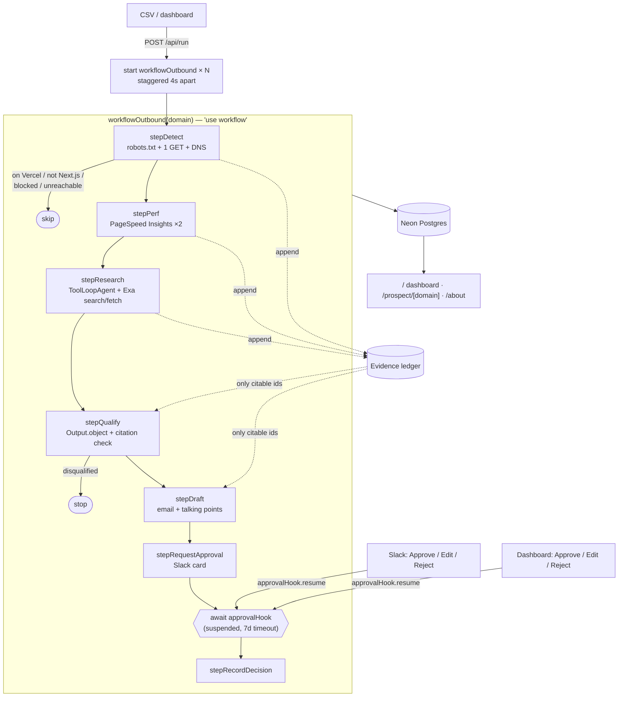

# Outbound Agent

An **outbound excellence agent**: it encodes how a top outbound rep finds and researches
companies running **Next.js on non-Vercel hosting**, then drafts personalized, fully
cited outreach for **human approval**.

It's [vercel-labs/lead-agent](https://github.com/vercel-labs/lead-agent) pointed at outbound.
It uses the same stack and patterns (Workflow DevKit, AI SDK + AI Gateway, the Agent
class, Exa, Slack Bolt on Vercel) and the git history starts from an unmodified import
of lead-agent, so every change is reviewable as a diff.

> Nothing is ever sent. "Approve" only marks a draft approved.

## What it does

For each domain in a CSV, one durable workflow:

1. **Detect**: one polite homepage fetch (robots.txt respected, identifying UA, timeouts,
   no headless browser) plus DNS. It scores Next.js confidence from `__NEXT_DATA__`,
   `self.__next_f`, `/_next/static`, `x-powered-by`, `x-nextjs-*` and `Vary: RSC`, and
   identifies the host (Vercel, Netlify, Cloudflare, AWS/CloudFront/Amplify, Fastly,
   Akamai, GCP, Azure, Render, Fly, …). **Already on Vercel → skip.**
2. **Measure**: PageSpeed Insights for mobile and desktop. Lighthouse lab LCP/CLS/TTFB/TBT
   and CrUX real-user p75 LCP/INP/CLS/TTFB are kept separate. Cached for 24h.
3. **Research**: lead-agent's Exa research agent with structured output: summary,
   size/funding, recent news, likely buyer, and why now. **Every item must cite a URL the
   tools actually returned.**
4. **Qualify**: fit score 0–100, reasoning, and the single strongest angle. Every claim
   cites evidence-ledger ids, and unknown ids are rejected in code.
5. **Draft**: a 60–120 word email in a helpful-engineer tone, plus 3 rep talking points.
   Numbers are checked against the ledger.
6. **Approve**: the workflow **suspends on a durable hook** until someone clicks
   Approve / Edit / Reject in Slack or on the dashboard.

## Architecture



### The evidence ledger (how "never invent facts" is enforced)

Every observation becomes an `EvidenceItem` with a stable id:

```
[detect.host.x-amz-cf-id]  x-amz-cf-id header (CloudFront) → aws: x-amz-cf-id: MQ4R…
[psi.mobile.field.ttfb]    Real-user TTFB, field p75 (mobile): 1840 ms
[research.news.0]          News (2026-06-12): Acme raises $40M Series B (source: https://…)
```

- `lib/grounding.ts` **drops research items** whose `sourceUrl` wasn't returned by a tool call.
- Qualification and draft claims must cite ledger ids. Unknown ids trigger **one repair
  pass**, then the claims are pruned.
- Numbers in the email that don't appear in the ledger are retried once, then shown to the
  reviewer as warnings.
- The UI renders every citation as a chip that jumps to the ledger row.

### Differences from lead-agent

| lead-agent | outbound-agent |
|---|---|
| Form → `start(workflowInbound)` | CSV / dashboard → `start(workflowOutbound)` per domain |
| Research agent returns free text | Same agent + Exa tools, **structured output**, grounded URLs |
| `techStackAnalysis` tool is a stub | Real detector + eval |
| `generateObject` category | `Output.object`: fit score, angle, cited claims |
| Slack post, then the workflow ends; buttons don't reach the run | Workflow **suspends on a hook**; Slack buttons carry the token and resume it |
| No storage | Neon Postgres (Marketplace) / PGlite locally |
| `workflow@4.0.1-beta`, `ai@5` | `workflow@4.8`, `ai@7` (`ToolLoopAgent`, `Output.object`) |

## Project structure

```
app/
  page.tsx                      dashboard (sortable/filterable, live-refreshing)
  prospect/[domain]/page.tsx    full brief: evidence, CWV, research, reasoning, draft
  about/page.tsx                pitch write-up
  api/run/route.ts              POST CSV/list → one workflow per domain
  api/slack/route.ts            Approve / Edit (modal) / Reject → approvalHook.resume
  api/prospects/[domain]/decision/route.ts   dashboard approvals
workflows/outbound/
  index.ts                      the durable workflow
  steps.ts                      'use step' functions (persist each stage)
  hooks.ts                      defineHook approval schema
lib/
  detect/                       fetch (robots, caps), nextjs + host rules, DNS
  psi.ts                        PageSpeed Insights + cache + CWV thresholds
  services.ts                   research agent, qualify, draft
  prompts.ts                    the rep playbook — tune behaviour here
  grounding.ts                  evidence ledger enforcement
  slack.ts                      Block Kit card + edit modal
  db/                           Drizzle schema (prospects, psi_cache)
eval/                           15 labelled domains + precision/recall script
```

## Run it

Prerequisites: Node 20+, pnpm.

```bash
pnpm install
cp .env.example .env.local        # fill in keys (see below)
pnpm db:migrate                   # Neon if DATABASE_URL is set, else local PGlite
pnpm dev
```

Start a batch from the dashboard (**Run domains**) or the CLI:

```bash
pnpm run:csv data/seed.csv
```

Other scripts:

```bash
pnpm detect nike.com linear.app   # detector only, no keys needed
pnpm eval                         # detection precision/recall
npx workflow web                  # inspect workflow runs locally
```

### Environment

| Var | Needed for | Notes |
|---|---|---|
| `AI_GATEWAY_API_KEY` | qualify, draft, research | Optional on Vercel / after `vercel env pull` (OIDC). The team needs a card on file to unlock AI Gateway's free credits. |
| `AI_MODEL` | — | Any Gateway model id; default `openai/gpt-5` (lead-agent's). |
| `EXA_API_KEY` | research | If unset, research is skipped and qualification uses detection + perf only. |
| `PSI_API_KEY` | performance | Keyless quota is effectively zero. After retries the run continues without perf. |
| `DATABASE_URL` | storage | Added by the Neon Marketplace integration. Falls back to PGlite in dev. |
| `SLACK_BOT_TOKEN`, `SLACK_SIGNING_SECRET`, `SLACK_CHANNEL_ID` | Slack approvals | Optional; the dashboard can approve too. |
| `RUN_SECRET` | prod | Required to start runs and approve from the dashboard. |
| `APP_URL` | Slack links | Defaults to the Vercel production URL. |

### Slack

1. Create an app **from manifest** using `manifest.json`, and set the interactivity URL to
   `https://<your-deployment>/api/slack`.
2. Install to your workspace, invite the bot to a channel, and set the three `SLACK_*` vars.
3. Qualified prospects are posted as a card with **Approve / Edit / Reject**. Edit opens a
   modal; submitting it saves the edit and approves.

### Deploy

```bash
vercel link
vercel integration add neon --plan free_v3    # free Postgres, sets DATABASE_URL
vercel env add EXA_API_KEY / PSI_API_KEY / RUN_SECRET / SLACK_*
pnpm db:migrate
vercel deploy --prod
```

## Results

### Detection eval (`pnpm eval`)

15 domains hand-labelled in a real browser (JS executed; DOM checked for
`#__NEXT_DATA__` / `self.__next_f` / `/_next/` scripts; headers from a same-origin fetch).
The detector only gets **one plain GET**.

| Metric | Result |
|---|---|
| Next.js precision / recall | **100% / 90%** (tp 9, fp 0, fn 1) |
| On-Vercel precision / recall | **100% / 75%** (tp 3, fp 0, fn 1) |
| Host accuracy | **93%** (14/15) |

The single miss (openai.com) is a Cloudflare bot challenge in front of a Next.js site on
Vercel: the plain GET only sees the challenge page. The pipeline marks that as
`blocked` and doesn't draft, so the miss can't turn into outreach to an existing
customer. Caveat: most eval domains are well-known sites, so treat this as a sanity check
rather than a benchmark (see `eval/README.md`).

### Sample detections

| Domain | Next.js | Host |
|---|---|---|
| mongodb.com | 0.98, Pages Router | AWS (CloudFront) |
| nike.com | 0.95, Pages Router | Akamai |
| ticketmaster.com | 0.95, Pages Router | Fastly |
| zillow.com | 0.90, Pages Router | AWS (CloudFront) |
| plaid.com | 0.90, Pages Router | AWS (ELB + CloudFront) |
| linear.app | 0.86, App Router | Cloudflare |
| supabase.com | 0.97, App Router | Vercel → skipped as customer |

### End-to-end runs

_Pending API keys (AI Gateway, Exa, PSI). Detection and workflow orchestration are verified
locally; qualification and draft output will be added here after the first full batch._

## License

MIT, as is the original [lead-agent](https://github.com/vercel-labs/lead-agent).
