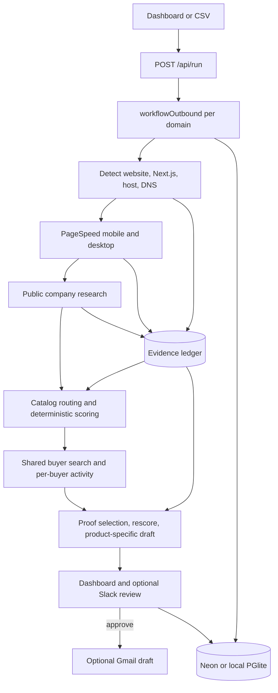

# System architecture

NextProspect is a Next.js App Router application with a durable Vercel Workflow
behind each submitted domain. The dashboard and API are thin entry points; the
workflow and library modules own the business rules.

## End-to-end flow

One workflow is started per normalized domain. Batches are staggered by four
seconds to reduce quota bursts. A new forced run expires old pending
opportunities so stale approval actions cannot remain live.

## Module ownership

| Area | Owner |
| --- | --- |
| Routes and rendered pages | `app/` |
| Reusable interface components | `components/` |
| Durable orchestration | `workflows/outbound/index.ts` |
| Persisted workflow stages | `workflows/outbound/steps.ts` |
| Product catalog and claims | `lib/catalog/` |
| Signal weighting and score caps | `lib/scoring.ts` |
| Opportunity routing, buyer assignment, drafting | `lib/opportunity-services.ts` |
| Buyer activity research | `lib/contact-activity.ts` |
| Evidence validation and citation repair | `lib/grounding.ts` |
| Website and host detection | `lib/detect/` |
| PageSpeed and CrUX | `lib/psi.ts` |
| Decisions and Gmail handoff | `lib/opportunity-decision.ts`, `lib/gmail.ts` |
| Slack cards and interactions | `lib/slack.ts`, `app/api/slack/route.ts` |
| Persistence | `lib/db/`, `drizzle/` |
| Weekly customer-proof maintenance | `workflows/maintenance/`, `lib/refresh/` |
| Test fixtures and scripts | `tests/` |

## Server and client boundaries

Pages are Server Components by default. Keep database reads, secrets, and
server-side integrations outside client component graphs. Add `'use client'`
only to the smallest component that needs state, browser APIs, or event
handlers.

Before changing a Next.js API or convention, read the matching guide under
`node_modules/next/dist/docs/`; this repository uses a version with breaking
changes relative to older training data.

## Write boundaries

- `POST /api/run` starts paid or quota-consuming work and requires
  `RUN_SECRET` outside development.
- Decision and Gmail-draft routes are privileged and validate the applicable
  run or opportunity token.
- Read pages are public for the demo. This is not sufficient authorization for
  a real multi-rep deployment; use Vercel Authentication or an application auth
  layer before exposing real account data.

## State model

`prospects` stores the latest account-level run state and shared evidence.
`opportunities` stores product-specific recommendations, contacts and their
attributable public activity, scores, selected proof/context IDs, drafts,
review state, and Slack/Gmail metadata. The opportunity review surface shows
buyer activity and Vercel precedent alongside each pitch, while labeling
competitor material as internal-only. `psi_cache` prevents redundant PageSpeed
work. `maintenance_runs` records weekly refresh outcomes, while `proof_records`
stores non-scoring customer proof and competitive context.

The account status is a summary for dashboard filtering. Each opportunity has
its own decision lifecycle and is the authoritative unit of review.

## Failure behavior

- Missing PSI or Exa configuration degrades the run and records a warning or
  empty evidence instead of fabricating data.
- PSI quota errors retry with backoff and eventually continue without metrics.
- Invalid research credentials fail fast and continue without research.
- Unexpected stage failures call `stepFail`, storing a bounded account error
  before the workflow rethrows.
- Failed accounts can be retried from the account error banner. The protected
  retry route clears the failed account state and starts a fresh durable run.
- Planner suppression is expected behavior and must not be rendered as an
  account-level fatal error.
